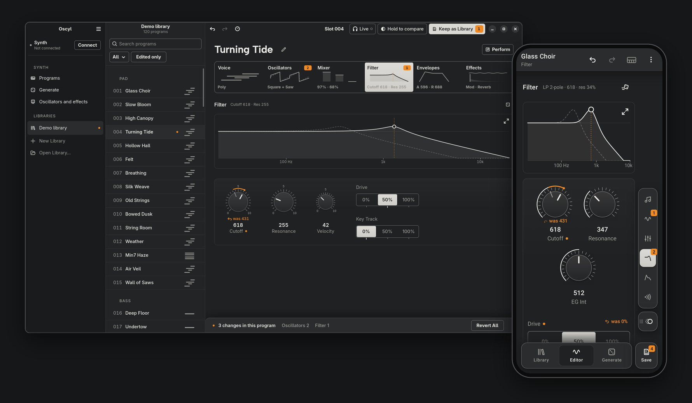
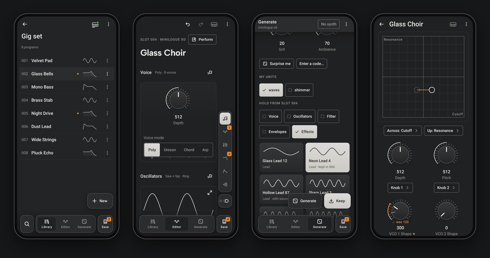

# Oscyl

**A free, open-source librarian and sound editor for hardware synths.** 
KORG minilogue xd, KORG prologue and Sequential Prophet Rev2, 
on Linux, Windows, macOS, Android, iOS and the command line.

[**Download**](https://github.com/oscyl/oscyl/releases) ·
[Website](https://oscyl.github.io/oscyl/) ·
[Source](https://github.com/oscyl/oscyl) ·
[Discussions](https://github.com/oscyl/oscyl/discussions)

<picture>
  <source media="(prefers-color-scheme: light)" srcset="https://raw.githubusercontent.com/oscyl/.github/main/profile/images/hero-light.png">
  
</picture>

## What it does

- **Library.** Read every program from your synth once, then organise,
  rename and back up with the synth unplugged.
- **Editor.** Every parameter, stage by stage, with a live graph. Each change
  plays on the synth at once; hold Compare to hear the saved sound.
- **Generate.** Six new sounds from a character and four dials, and new
  user oscillators for the minilogue xd and prologue.
- **Safe sync.** Oscyl backs up the slots it will touch, then writes only the
  programs you changed. Factory slots never change.

<picture>
  <source media="(prefers-color-scheme: light)" srcset="https://raw.githubusercontent.com/oscyl/.github/main/profile/images/tour-light.png">
  
</picture>

## Synths

| Synth | State |
|-------|-------|
| KORG minilogue xd | Validated on hardware |
| KORG prologue (8 and 16) | Proven against its simulator; hardware testers wanted |
| Sequential Prophet Rev2 | Proven against its simulator; hardware testers wanted |

## Platforms

| Platform | Get it |
|----------|--------|
| Linux | Flatpak (GNOME app) and the `oscyl` CLI |
| Windows, macOS | Desktop app and CLI; not yet tested with a synth |
| Android | APK for phones, foldables and tablets |
| iOS | [Build from source](https://github.com/oscyl/oscyl/blob/main/docs/building.md#ios) |

All downloads are on the [Releases](https://github.com/oscyl/oscyl/releases)
page. Oscyl is **pre-alpha**.

## Help wanted

Hardware testers, drivers for more synths and translations. Start with
[CONTRIBUTING.md](https://github.com/oscyl/oscyl/blob/main/CONTRIBUTING.md)
and the [driver guide](https://github.com/oscyl/oscyl/blob/main/docs/drivers.md),
or ask in [Discussions](https://github.com/oscyl/oscyl/discussions).

Oscyl is an independent project under MIT OR Apache-2.0, not affiliated
with or endorsed by any synth maker. "KORG", "minilogue", "prologue" and
"logue" are trademarks of KORG Inc.; "Sequential" and "Prophet" are trademarks
of their owner.
